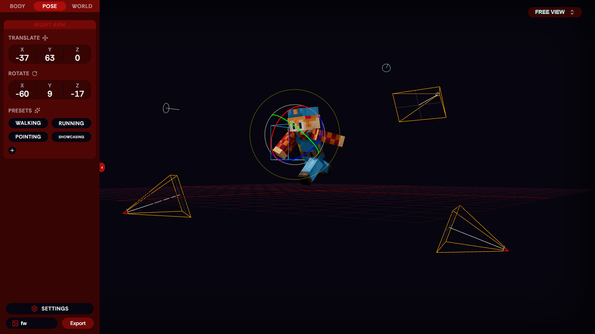
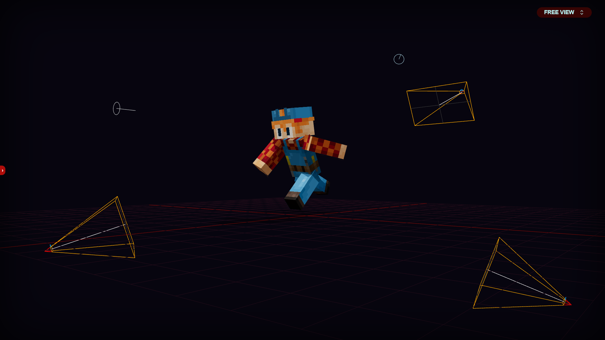
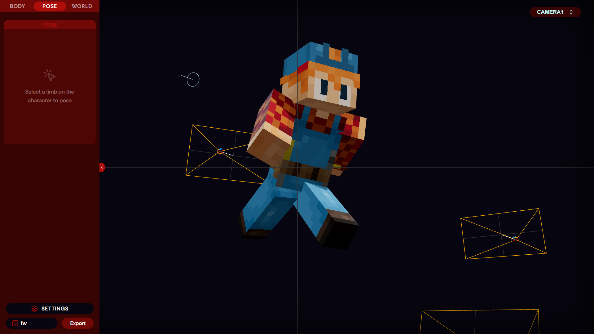
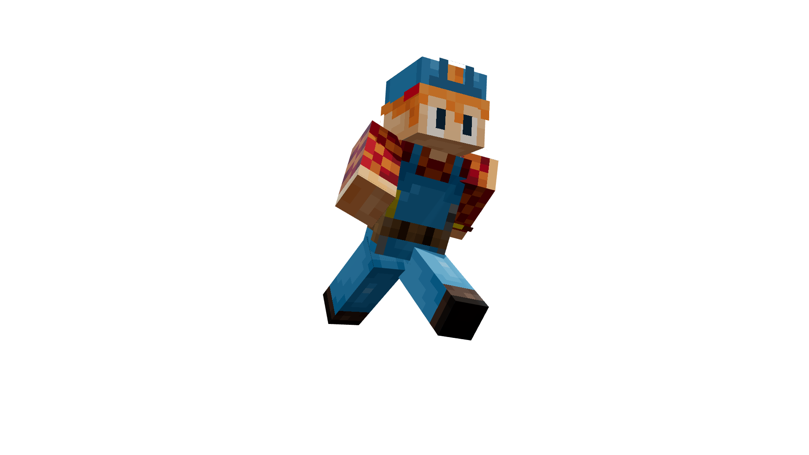
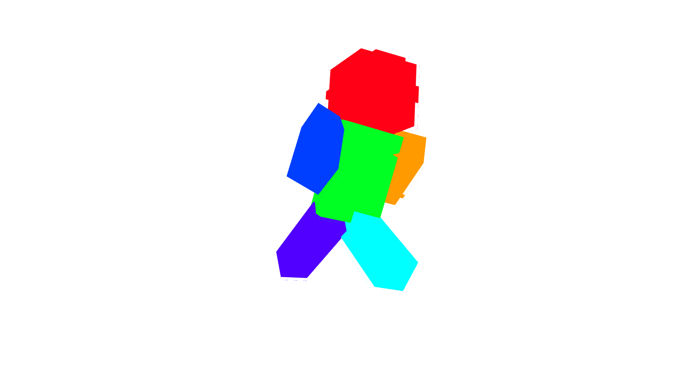
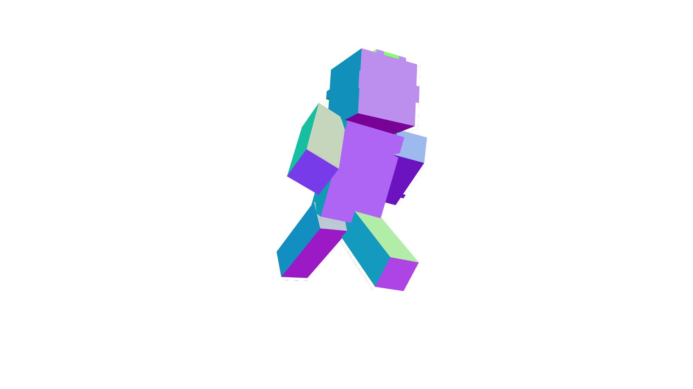

# MCRndr (Alpha)

> NOT AN OFFICIAL MINECRAFT PRODUCT. NOT APPROVED BY OR ASSOCIATED WITH MOJANG OR MICROSOFT.
>
> Early Alpha (v0.1.0-alpha): Active development preview. Posing, lighting, and 4K export passes are fully functional; tools and interface are actively being updated.

A fast, free tool in your browser to pose Minecraft skins, set up custom lighting, and export Photoshop-ready cutouts for YouTube thumbnails. No heavy 3D software required.

---

## Overview


<p align="center"><sub>Figure 1: Main staging workspace. Click any limb to rotate or move it, tweak angles, and view camera placements.</sub></p>

---

## Camera Angles & Framing

| Clean Stage (Hidden UI) | Camera View (Framing Guide) |
| :---: | :---: |
|  |  |
| <sub>Figure 2: Full-screen view showing your character, ground grid, and light markers.</sub> | <sub>Figure 3: Dedicated camera view with center crosshairs to frame thumbnail action shots.</sub> |

---

## Photoshop-Ready Export Passes

MCRndr exports transparent PNGs up to 4K resolution. Instead of just a flat picture, it gives you dedicated layers tailored for thumbnail designing in Photoshop, Photopea, or GIMP:

| Beauty Render | Clown Selection Mask |
| :---: | :---: |
|  |  |
| <sub>Figure 4: Fully shaded character with lighting and soft shadows on a clean transparent background.</sub> | <sub>Figure 5: Color-coded limbs. Use Photoshop Magic Wand (Tolerance 0) to select arms, legs, or head in one click.</sub> |
| Normal Map (Rim Lighting) | Silhouette Cutout (WEM) |
|  |  |
| <sub>Figure 6: Directional surface colors. Blend in Photoshop to paint realistic rim lights, glows, and reflections.</sub> | <sub>Figure 7: Pure white character shape. Perfect for creating thick thumbnail outlines, sticker strokes, or drop shadows.</sub> |

---

## Built for Thumbnail Creators

- Drag & Drop Any Skin: Drop your .png skin directly into the window. MCRndr automatically detects classic 4px Steve arms or 3px slim Alex arms, plus jackets, hats, and outer 3D layers.
- Simple Limb Posing: Click limbs to rotate and translate them. Use preset buttons (Running, Walking, Pointing) for quick starts, or hotkeys (G to move, R to rotate).
- Unlimited Undo: Hit Ctrl+Z anytime. 60 steps of history keep your posing stress-free.
- Dynamic Lighting: Click and drag sun and point lights in 3D space. Switch between realistic soft shadows or authentic in-game blocky lighting.
- Multiple Cameras: Create multiple camera angles around your character, change FOV for dramatic wide-angle perspectives, and switch angles instantly.
- High-Resolution Exports: Save individual renders or batch export all compositing passes at 1080p, 2K, or 4K with clean transparent alpha backgrounds.

---

## Quick Start (Run Locally)

### Requirements

Node.js (v18 or newer) and npm.

### Setup

```bash
git clone https://github.com/CaptainBirdeloper/MCRndr.git
cd MCRndr
npm install
npm run dev
```

Open the displayed localhost URL in your browser to start posing.

---

## Disclaimer

NOT AN OFFICIAL MINECRAFT PRODUCT. NOT APPROVED BY OR ASSOCIATED WITH MOJANG OR MICROSOFT.
Minecraft is a trademark of Mojang Synergies AB.

---

## License

This project is licensed under the GNU General Public License v3.0 - see the [LICENSE](LICENSE) file for details.
